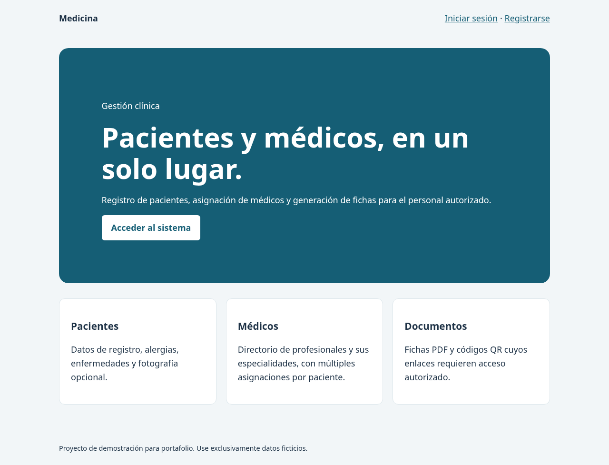
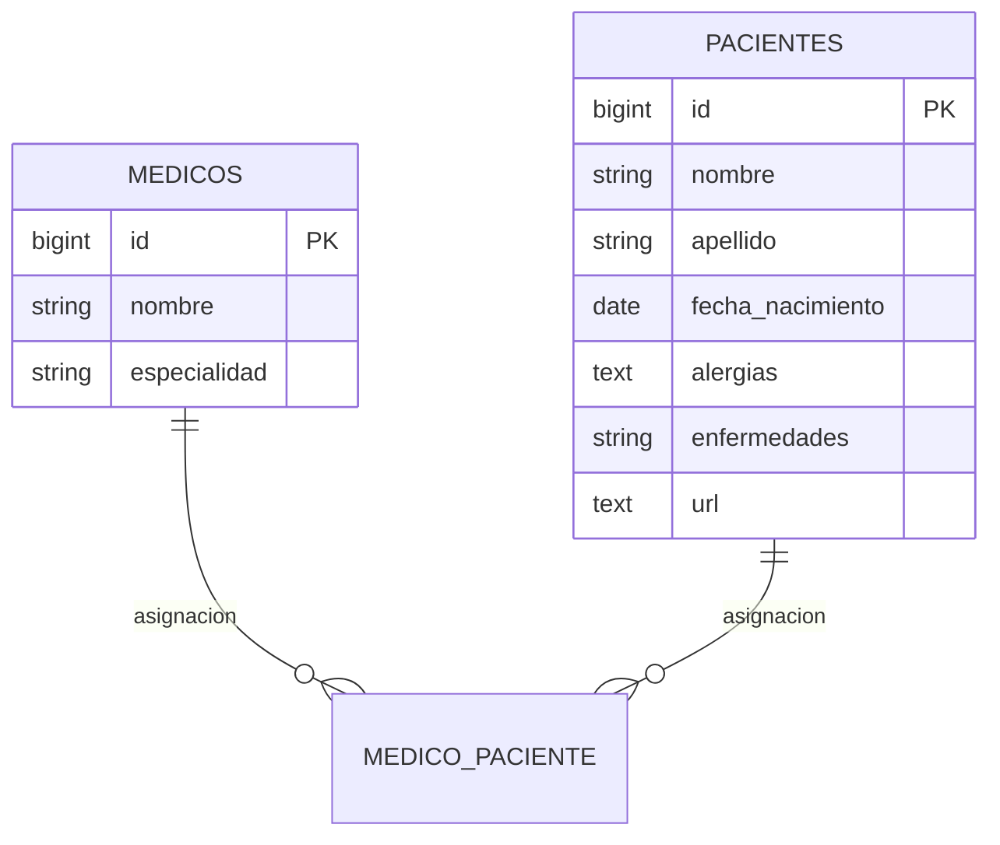

# Medicina · Gestión clínica

Aplicación Laravel para registrar pacientes, gestionar médicos y especialidades, asignar varios profesionales a un paciente y generar fichas PDF con fotografía y acceso mediante QR. Conserva el propósito del proyecto Medicina2025 y corrige sus problemas de acceso, integridad y manejo de archivos.

**Demostración para portafolio:** utilice exclusivamente datos ficticios. No incluye pacientes, fotografías clínicas, cuentas predeterminadas ni credenciales.



## Funcionalidades comprobadas

- Registro de cuentas, inicio y cierre de sesión. Las cuentas nuevas requieren autorización explícita para acceder a los módulos clínicos.
- Alta, listado paginado, edición y eliminación de pacientes y médicos.
- Múltiples médicos por paciente, con validación de identificadores y conservación de las selecciones al editar.
- Protección contra eliminación de médicos con pacientes asignados, también mediante claves foráneas.
- Fotografía opcional por archivo o cámara; vista previa, mensajes de error y cierre del dispositivo al terminar.
- Fotografías privadas, validadas y recodificadas a JPEG sin conservar el nombre original ni sus metadatos EXIF.
- PDF con datos del paciente, sus médicos y fotografía embebida. Fuente DejaVu Sans incluida en DomPDF, sin fuentes remotas.
- QR en SVG hacia el PDF protegido: escanearlo **no** concede acceso ni incluye datos clínicos.
- Formularios adaptables a móviles y mensajes de validación y confirmación.

## Tecnologías

PHP 8.2+, Laravel 12, Eloquent, Blade, Laravel UI, AdminLTE 3, Bootstrap, JavaScript, Vite 8, DomPDF y Simple QrCode. SQLite para la instalación de demostración; se conserva la configuración de MySQL, pero esa base no se validó en esta revisión. PHPUnit y Playwright para las pruebas.

Laravel 11.37 del archivo original se actualizó a Laravel 12 porque Laravel 11 ya terminó su soporte de seguridad. No se cambió de framework.

## Requisitos

- PHP 8.2 o superior; probado con PHP 8.4.27.
- Extensiones PDO SQLite, GD, mbstring, DOM/XML, fileinfo, iconv, OpenSSL, ctype y tokenizer. Curl y ZIP se recomiendan para Composer. Para MySQL se necesita PDO MySQL.
- Composer 2, Node.js 22.12 o Node.js 24+ y npm.
- Permisos de escritura en `storage/` y `bootstrap/cache/`.
- La cámara requiere HTTPS o localhost, permiso del usuario y un dispositivo compatible.

## Instalación local

```bash
git clone https://github.com/isaiasdevco/Medicina.git
cd Medicina
composer install --prefer-dist --no-interaction
npm ci
cp .env.example .env
php artisan key:generate
touch database/database.sqlite
php artisan migrate
php artisan adminlte:install --only=assets --force
npm run build
php artisan serve
```

No ejecute `cp .env.example .env` sobre una configuración existente. En Windows cree el archivo SQLite vacío con `New-Item database/database.sqlite -ItemType File`, si todavía no existe.

Abra la dirección indicada por Artisan. No hace falta un servicio de base de datos externo para SQLite. Los recursos de AdminLTE se generan desde la dependencia Composer y no se versionan. Las URL de archivos GitHub en `composer.lock` usan su servicio oficial `codeload.github.com`, conservando las referencias de cada paquete, para permitir instalaciones detrás del proxy del entorno.

Para desarrollar los recursos de interfaz, ejecute `npm run dev` en otra terminal; al terminar, detenga Vite y vuelva a ejecutar `npm run build` para trabajar sin él. No conserve `public/hot` de otra máquina.

## Cuentas y permisos

1. Registre una cuenta desde la interfaz. Al iniciar sesión verá que está pendiente de autorización.
2. Desde una consola de confianza, el responsable del sistema habilita el acceso:

   ```bash
   php artisan app:authorize-staff tu-correo@example.com
   ```

3. Recargue la página. Ya puede gestionar médicos y pacientes.

Para retirar el permiso:

```bash
php artisan app:authorize-staff tu-correo@example.com --revoke
```

El permiso `is_staff` no es asignable por los formularios. Todo el personal autorizado comparte el directorio clínico; no existe aislamiento por centro, usuario o médico. No se crean cuentas al ejecutar los seeders. La recuperación de contraseña requiere configurar un servicio de correo real: `MAIL_MAILER=log` solo sirve para desarrollo.

## Modelo y archivos



Las fotos nuevas se guardan en `storage/app/private/pacientes/fotos/`. Solo se entregan desde una ruta autenticada y autorizada; no necesitan `storage:link`. El tamaño máximo admitido es 4 MiB y 3000 × 3000 píxeles. Opcionalmente se puede configurar `PATIENT_PHOTO_ROOT` con una ruta privada fuera del directorio web.

Eliminar un paciente elimina sus asignaciones y fotografía; **la eliminación es definitiva**. Eliminar un médico asignado se bloquea hasta reasignar los pacientes. Las operaciones de base de datos usan transacciones y los archivos nuevos se limpian si la persistencia falla.

## Actualizar una instalación anterior

No use `migrate:fresh` en una base existente: borra los datos.

1. Active mantenimiento con `php artisan down` y haga copias privadas verificadas de la base de datos y de las fotos.
2. Actualice código y dependencias, manteniendo el `.env` y la clave de la instalación.
3. Ejecute `php artisan migrate --force`. La migración copia el médico anterior de cada paciente a la tabla intermedia antes de retirar la columna antigua y su cascada peligrosa.
4. Ejecute `php artisan app:privatize-photos`. Recodifica las fotos antiguas referenciadas desde los discos público/local al disco privado, actualiza las referencias y elimina los originales solo después de guardar la nueva referencia. Es repetible.
5. Si el comando informa archivos ausentes, demasiado grandes o fotos públicas sin referencia, resuélvalos antes de continuar. Las fotos huérfanas deben archivarse fuera del directorio público; el comando no las borra automáticamente. Revise también cualquier enlace público antiguo y elimínelo si no es necesario para otros recursos.
6. Autorice explícitamente las cuentas de personal, compile los recursos y verifique la aplicación antes de ejecutar `php artisan up`.

No se permite revertir la migración de relaciones si existen pacientes: volver a un único médico descartaría información. Para deshacer esa actualización, restaure una copia verificada.

## Pruebas

```bash
php artisan test
vendor/bin/pint --test app bootstrap/app.php bootstrap/providers.php config database routes tests
composer validate --strict
composer check-platform-reqs
npm run build
npm audit
composer audit --locked
```

Las pruebas PHP fuerzan SQLite en memoria para no tocar su base local. Cubren autenticación y permisos, CRUD, validación, múltiples médicos, restricciones de borrado, migración de datos anteriores, fotos y PDF/QR.

Prueba de navegador, con base y fotografías temporales y cámara sintética:

```bash
npx playwright install chromium
npm run test:browser
```

En una máquina sin las bibliotecas del navegador, use el procedimiento de instalación de dependencias de Playwright correspondiente al sistema. Si ya tiene Chromium, puede usar `PLAYWRIGHT_CHROMIUM_EXECUTABLE=/ruta/a/chromium npm run test:browser`.

El script inicia y detiene su propio servidor, comprueba CSRF mediante HTTP real, recorre formularios, decodifica el QR y revisa el ancho móvil. No requiere cuentas predeterminadas ni credenciales de una instalación real. Ejecútelo con la configuración sin cachear (`php artisan config:clear`) y después de `npm run build`.

La configuración de GitHub Actions incluida prepara PHP, compila recursos y ejecuta las pruebas; su ejecución remota debe comprobarse en la pestaña Actions. Los resultados observados y sus límites están en [la revisión técnica](docs/REVISION.md).

## Seguridad y despliegue

`.gitignore` excluye `.env`, bases SQLite, volcados SQL, fotos, logs, cachés, ZIP, dependencias y recursos generados. `.env.example` no contiene secretos y desactiva debug.

Para cualquier despliegue fuera del desarrollo local, configure HTTPS, `APP_ENV=production`, `APP_DEBUG=false`, una clave propia, `SESSION_SECURE_COOKIE=true`, correo autenticado y copias de seguridad privadas. El directorio web debe ser exclusivamente `public/`. No exponga los archivos de `storage/app/private/`.

Este proyecto demuestra un flujo de gestión clínica; no se ha certificado para uso con datos reales, ni incorpora controles de cumplimiento normativo, auditoría clínica o recuperación operativa de un sistema hospitalario.

## Descripción para portafolio

> Aplicación de gestión clínica desarrollada con Laravel y PHP para administrar pacientes y médicos, con relaciones de múltiples profesionales, fotografías privadas y generación de fichas PDF y códigos QR protegidos. Incluye validación de datos, autorización del personal, restricciones de integridad y pruebas automatizadas de backend y navegador.
